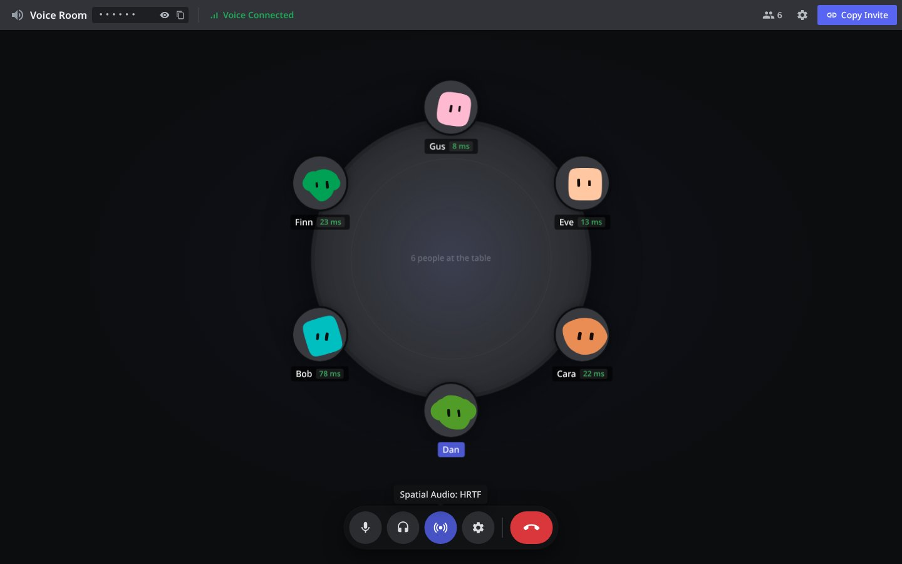
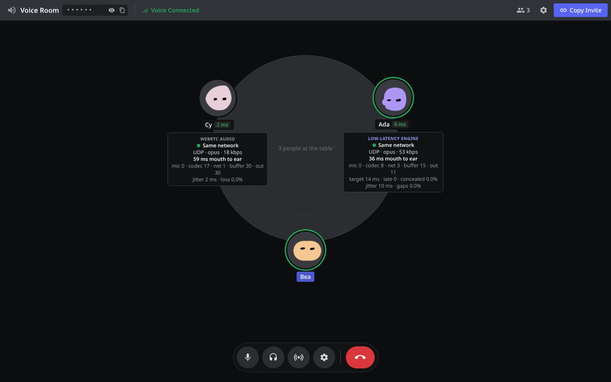
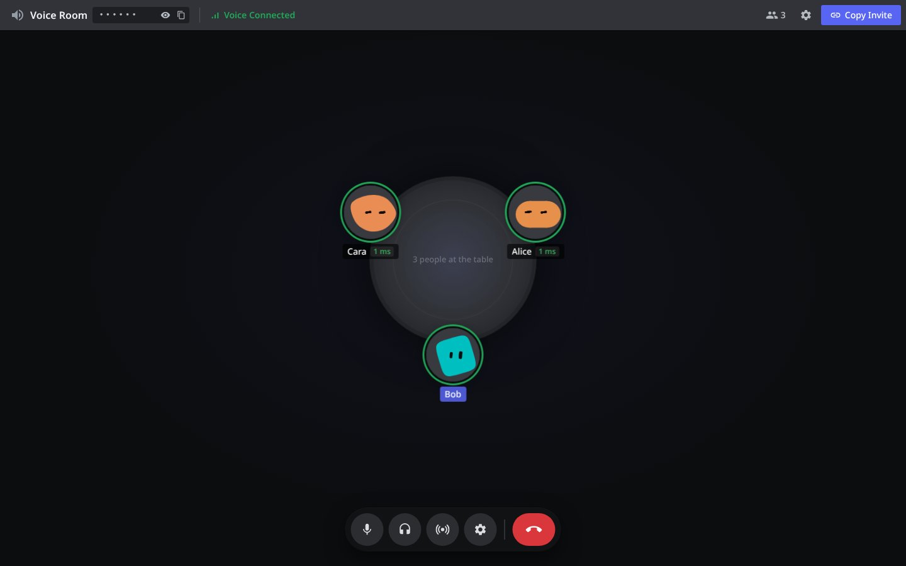
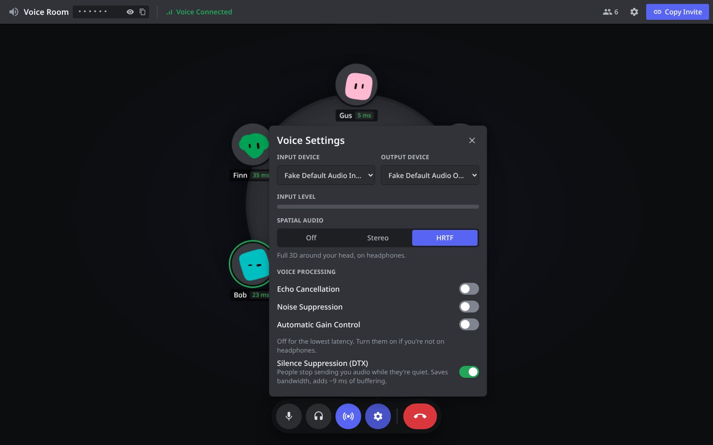
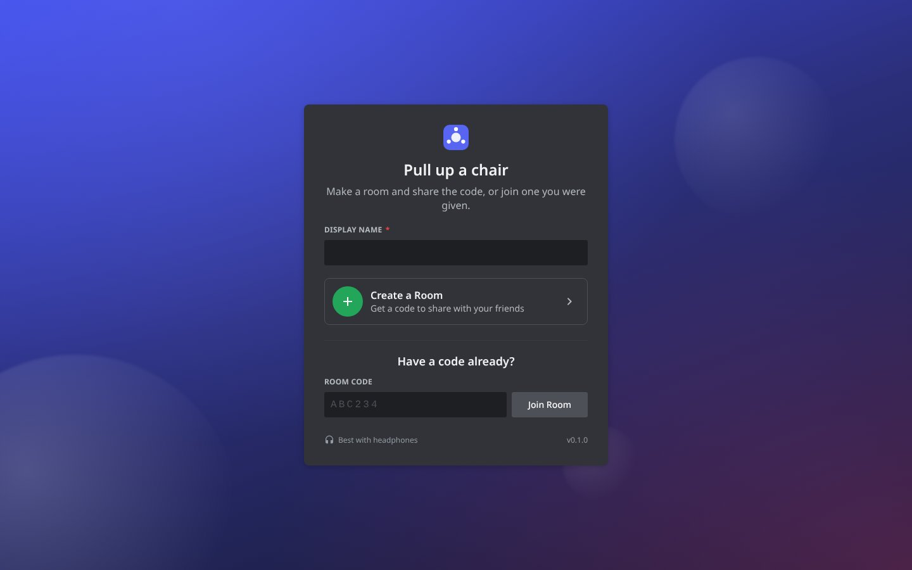
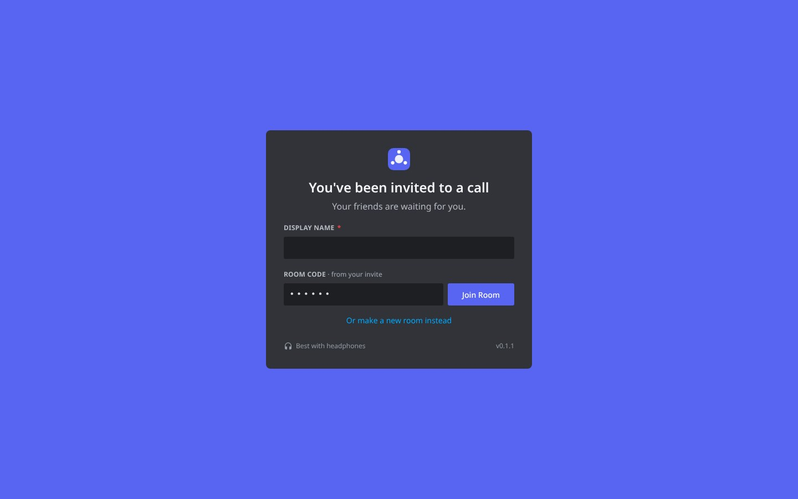
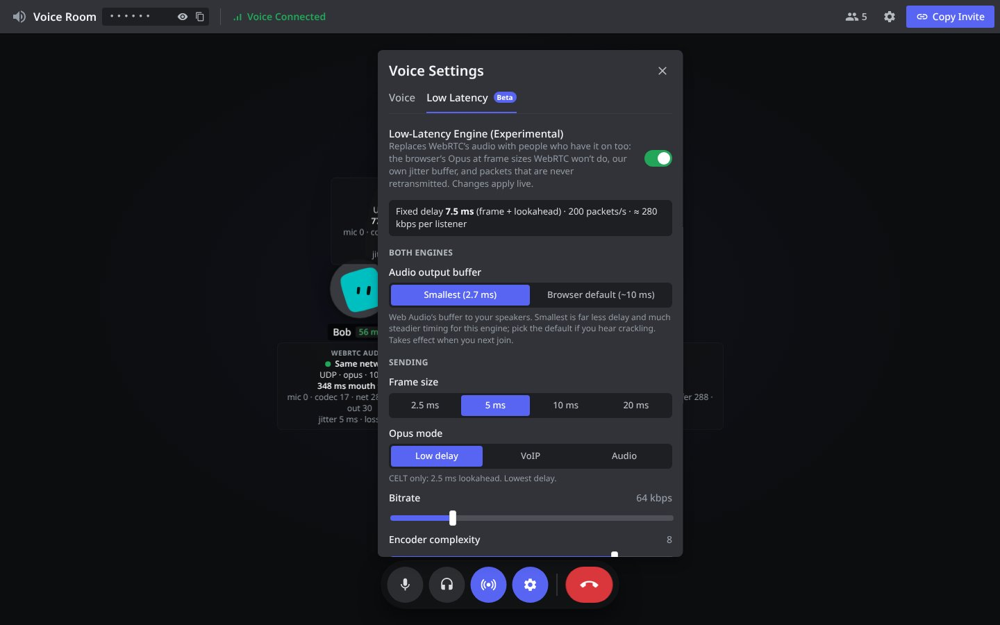

# Pivoice

**Voice rooms around a round table.** Make a room, share the code, talk.

Everyone sits around a table seen from above. You're always at the bottom,
and everyone else is spread evenly around it. When people join or leave, the
others slide to their new seats, each moving as little as possible. Turn on
spatial audio and each voice comes from where that person sits.

<p>
  
  
</p>
<p>
  
  
</p>
<p>
  
  
</p>

Built for the lowest latency first, desktop first, and for people on
headphones. No accounts, no server in the middle of the audio.

## Try it

You need Node 22.12 or newer (CI uses 24, see `.nvmrc`).

```sh
npm install
npm run dev          # the app on :5173 and the Worker (rooms included) on :8787
npm run e2e          # optional, in another terminal: headless Chromium tabs with fake mics, end to end
npm run e2e:native   # optional: the app, headless on a fake sound card, with people on the website (build it first, see The app)
```

Open it in two browsers (or two profiles), make a room in one and join with
the code in the other. Microphone permission is needed on `localhost` or
HTTPS. Everything runs on your machine: `npm run dev` starts Vite and
`wrangler dev` side by side, Vite passes `/api` (WebSockets too) through to
the Worker, and the rooms' Durable Objects run locally in workerd. No
Cloudflare account is needed for any of it. `npm run dev:app` and `npm run
dev:worker` start just one half.

The e2e run makes a room, has people join, checks everyone hears everyone
(the fake mic beeps, which lights up speaking rings on the other screens),
mutes, has whoever made the room leave and checks the call carries on, joins
someone new after that, and fills the table to six. It needs Playwright
installed (`npm i -g playwright && npx playwright install chromium`).
`SHOTS_DIR=docs/screenshots npm run e2e` retakes the screenshots above.

`npm test` runs the unit tests (seat planning against brute force, the
springs, the protocol, the Opus SDP tuning, the Worker and the rooms), and `npm run
typecheck` / `npm run typecheck:worker` the types.

## What's in it

**Start screen.** No landing page: a name, **Create a Room**, or a room code
and **Join Room**. An invite link (`…/#CODE`) opens straight to the join form
with the code filled in, dotted out, and taken out of the address bar.

**The table.** Top down: a flat round table, you at the bottom, everyone else
evenly around it. It's half size for one to three people and grows to full
size by eight, easing outward as people sit down. Everyone's face is a [blobatar](https://blobatar.dev) made
from their name, so the same name is the same creature on everyone's screen.
Faces smile while they talk, doze off while deafened and look puzzled while
reconnecting. They're still pictures, not animations: animated blobatars
restyle every face every frame on the main thread, which took a whole core
with six at the table and showed up as wandering latency. A green ring shows who's talking, and mute and deafen show next to
their names, along with your ping to each of them (green under 80 ms, yellow
under 160, red above). Right-click someone for **User Volume** and **Mute**
(for you only).

**Call controls.** A floating pill at the bottom: mute (`Ctrl+Shift+M`),
deafen (`Ctrl+Shift+D`), spatial audio, voice settings, disconnect. Like
Discord, deafening mutes you too and unmuting undeafens you.

**Mic test.** In Voice Settings, like Discord's **Let's Check**: you hear
yourself, deafened while it runs (and undeafened after, if you weren't
before), through one of three paths, none of them touching the network:

- **Raw**: the mic straight to your ears through Web Audio. This is your
  devices plus the browser's buffers, the floor every other path sits on.
  Shown as what the browser reports for its buffers (it can't be measured
  without a microphone hearing your speakers).
- **WebRTC audio**: two peer connections in the tab, with the same SDP tuning
  as a call, played out the way calls play. Measured from capture stamps.
- **Low latency**: the low-latency engine's whole path, looped back inside
  its worker: silence gate, encoder, packets, decoder, jitter buffer. Measured
  from capture stamps, with the buffer, concealment and late counts alongside.

In headless Chromium (fake devices): raw ≈ 11 ms, WebRTC audio 45 ms, the
low-latency engine 24 ms. If the engine sounds choppy in its loopback, the
cause is on your machine (output buffer, silence gate), not the network.

**Settings apply immediately.** The two settings that only a fresh
connection can apply (the audio output buffer, and silence suppression on
WebRTC audio) reconnect you on the spot. You drop and come straight back
as the same member, without saying goodbye. The room keeps you as
reconnecting for those few seconds, so you keep your seat, and the volumes
everyone has set for you still apply. If you were alone, you take the room
back with the same code.

**Flat and sharp.** No gradients and no blurred shadows: flat colours,
hard 1px edges. Seats at rest sit on whole pixels with no scaling, and
nothing is centred with a −50% transform, so faces and text are never
resampled.

**Room code, hidden by default.** The header shows `••••••` with buttons
to show it and to copy it, so you can screen share without giving the room
away. **Copy Invite** copies the link without showing it. The code shows in
the middle of the table only while you have it revealed.

**Display settings** (the gear in the top bar). **Show ping** (on) and **Show
audio route** (off). The route card under each person shows how their audio
reaches you (same network, direct peer to peer, or relayed through a TURN
server, and which one), the transport, codec and bitrate, a mouth-to-ear
estimate with its breakdown (mic, codec, network, jitter buffer, playout),
and jitter and packet loss. It's all read once a second from the calls'
own WebRTC stats, and it also says which engine is carrying that person's
voice. Those stats are only read while the route card is up: `getStats()`
stalls Chrome's network thread, where the low-latency engine's packets
come in, and its jitter buffer grows to cover the stall (p90 mouth to ear
went from 22.7 to 25–26 ms with the poll on). Ping to people on that
engine comes from its own pings over its data channel instead. The mouth-to-ear figure is measured where it can be (see below), and
an estimate (`≈`) where it can't. Hover the estimate for what each part means.

**Voice settings.** Input and output device, an input level meter,
spatial audio (**Off**, **Stereo**, **HRTF**), echo cancellation, noise
suppression and automatic gain control (all **off** by default), and
silence suppression (DTX, off). The **Low Latency** tab has the experimental
engine and all its settings (below).

### Seating

Angles are measured from your seat at the bottom, clockwise. With N people
the seats are at 2πk/N. Nobody ever slides through your seat, so everyone
else keeps their order around the table.

When someone joins or leaves, [`planSeats`](src/lib/seats.ts) picks which of
the new seats the people already sitting take, keeping their order, so the
total squared distance travelled is as small as possible. It's a small DP over
people × seats, tested against brute force. Squared, so one person doesn't
do all the travelling while everyone else sits still. Newcomers take the
seats left over and fade in. People who leave fade out where they are.

The motion is done in JavaScript: each seat's angle is a critically damped
spring, stepped every animation frame, and it moves along the table's edge,
not in a straight line across it. A change halfway through a move keeps the
seat's speed, so it bends toward its new spot instead of restarting. Because
the angle is known every frame, the spatial audio reads it directly. The loop
stops when everything is still. With reduced motion on, seats jump straight
to where they're going.

### Audio and latency

- **A full mesh of WebRTC calls.** Everyone calls everyone directly, with no
  SFU or relay in the middle unless the network forces TURN. That's the
  lowest latency you can get, and fine for the 12 people a room allows.
- **Raw microphone.** Echo cancellation, noise suppression and auto gain are
  off unless you turn them on. Each adds processing delay, and everyone's on
  headphones.
- **10 ms Opus frames.** The SDP each side sends asks for `ptime=10`
  instead of 20 ms, with in-band FEC and mono
  ([`src/net/sdp.ts`](src/net/sdp.ts)). Measured: 100 packets a second.
  Senders are marked high priority for networks that honour DSCP.
- **Nothing sent that nobody will hear.** While you're muted (deafening
  mutes you too), your calls carry no audio track at all, so no packets go
  out. A disabled track would still send encoded silence 100 times a second.
  Nobody sends audio to someone who's deafened. Swapping the track back is
  instant and needs no renegotiation.
- **Silence suppression (DTX), off by default.** With it on, while someone's
  quiet Opus sends a small comfort-noise update every 400 ms instead of 100
  packets a second, and resumes on the first frame of speech, so nothing is
  clipped. It costs about 9 ms: measured in Chrome, the jitter buffer sat at
  ~36 ms with it and ~27 ms without. Turn it on in Voice Settings to save
  bandwidth while people are quiet. It applies to what people send *you*. Changing it reconnects you for
  a moment, since it's part of how each call is set up.
- **Spatial audio off by default.** With it off, each voice plays from a plain
  `<audio>` element, the shortest path the browser has from the network to your
  ears.
- **Spatial audio on:** each voice goes `gain → PannerNode → speakers`.
  **Stereo** uses equal-power panning. **HRTF** uses the browser's built-in
  head-related transfer function (`panningModel: 'HRTF'`, in every modern
  browser, so no library is needed) for full 3D on headphones. You sit at the
  bottom facing the middle, so the far side of the table is in front of you
  and the seat on your left is ahead-left. Only the direction counts:
  nobody's quieter for sitting further away. There's no head tracking.

**Where the rest of the delay is.** Measured on one machine, Chrome to Chrome
(the network part is ~1 ms):

| Stage | Delay | Who controls it |
| --- | --- | --- |
| Mic capture | ~10 ms (as Chrome reports it) | Chrome and your audio server |
| Opus frame + lookahead | 10 + ~6.5 ms | us (10 ms is libwebrtc's smallest Opus frame) |
| Network | ½ the round trip | the network |
| Jitter buffer | ~27 ms (Chrome's floor here was ~28 ms), +9 with DTX | Chrome's NetEq. Pages can only raise its minimum. |
| Playout to speakers | ~30 ms | Chrome and your audio server |

That's ~85–95 ms mouth to ear even on one machine, against the ~10–20 ms of
something like `pw-loopback`, and most of it is inside the browser's WebRTC
audio, where a page can't reach. That's why there's a second engine (next
section).

Outside the app, on Linux with PipeWire, a large audio buffer size shows up
three times: in mic, in out, and as jitter that grows the buffer. A mic
reading of ~21 ms is a 1024-sample buffer. `pw-metadata -n settings 0
clock.force-quantum 256` (0 puts it back), or starting Chrome with
`PULSE_LATENCY_MSEC=5`, shrinks it.

**Measured, not guessed.** The route card's mouth-to-ear figure is a real
measurement whenever it can be (no `≈`):

- WebRTC audio: our offers ask for the `abs-capture-time` RTP header
  extension. Each frame then carries the wall-clock time it was captured at,
  `getSynchronizationSources()` reports it next to when the frame was handed
  to our audio output, and Chrome's playout delay is added on top.
- Low-latency engine: one packet in 20 carries the wall-clock capture time of
  its newest frame, and the playback worklet reports which frame it played
  when.

Both measure capture to speakers. That's exact on one machine; across machines
it's as good as your two clocks (NTP usually keeps desktops within a few ms).

### The low-latency engine (experimental)

On by default, sending raw PCM, in **Voice Settings → Low Latency**. Pairs
of people who both have it on stop using WebRTC's audio for each other and
use this instead. PCM is about 1.3 Mbit/s to each person you're talking to,
so on a slow uplink switch the codec to Opus or turn the engine off:

```
mic → pv-capture AudioWorklet: frames of 2.5–20 ms on the audio clock (one 2.7 ms block for PCM)
    → shared-memory ring → worker: our silence gate → WebCodecs AudioEncoder (the browser's libopus), or raw PCM
    → packet: frame + the previous 0–2 frames again + now and then a capture stamp
    → RTCDataChannel, unordered, maxRetransmits 0 (late is dropped, never queued)
    → their worker: WebCodecs AudioDecoder (or straight through for PCM)
    → shared-memory ring → pv-playback AudioWorklet: our jitter buffer → their channel strip (volume, spatial)
```

- **No main thread in the audio path.** The capture worklet hands frames
  straight to a dedicated worker through a lock-free ring in a
  SharedArrayBuffer (the worker wakes on `Atomics.waitAsync`, the playback
  worklet reads its ring at the top of each block), the data channels are transferred to
  that worker the moment they're created (Chrome only allows it then), and
  decoded audio goes straight from the worker to the playback worklet. Page
  work can't delay a packet. Where a browser can't transfer a data channel,
  the page relays instead. Shared memory needs the page to be cross-origin
  isolated, so the Worker sends `Cross-Origin-Opener-Policy: same-origin` and
  `Cross-Origin-Embedder-Policy: require-corp` on everything (so does the
  Vite dev server). Without isolation the engine falls back to MessagePorts;
  the tab says which it's using.
- **Raw PCM by default, for local networks.** No encoder and no lookahead: each 128-sample
  block (2.7 ms) goes out as 16-bit PCM the moment the audio thread has it.
  The fixed delay drops to one block, at about 1.3 Mbit/s per listener (more
  with redundancy). Opus at 2.5 ms still costs a frame plus 2.5 ms of
  lookahead.
- **Opus at frame sizes WebRTC won't do.** WebCodecs' Opus takes
  `frameDuration` down to 2.5 ms and `application: 'lowdelay'`, which means
  CELT only and 2.5 ms of lookahead instead of 6.5. Encoding a frame takes
  ~0.2 ms.
- **Our own jitter buffer** ([`src/audio/ll/jitter.ts`](src/audio/ll/jitter.ts)):
  - It tracks the best path delay (the minimum of arrival minus send time
    over a few seconds) and a high percentile (99th) of the jitter above it,
    and aims for jitter × multiplier + margin, clamped to a minimum and
    maximum.
  - It steers toward that target by changing playback speed by up to a few
    %. Gaps are covered by fading out the last frame. After a silence it
    starts the next sentence fresh at the target.
  - Unit tests drive it with simulated streams: clean, jittery, lossy and
    silent ones.
- **Our own DTX.** Chrome's encoder drops frames for DTX and then numbers the
  rest as if it hadn't (its decoder does the same with gaps), which scrambles
  timing. So the engine keeps its own map from each frame to its capture time,
  and gates silence itself. The gate decides per frame from that frame's own
  level, with a hangover (400 ms), so the start of a word is never waited
  on. The threshold is low (−70 dBFS) because the mic comes in raw with no
  auto gain: in 0.2.0 it was −55, which could chop quiet speech.
- **Redundancy instead of FEC.** WebCodecs' decoder can't use Opus's in-band
  FEC, so each packet can repeat the previous one or two frames. One lost
  packet then costs nothing, and there's no extra delay.
- **Smallest output buffer** (applies to both engines): the AudioContext is
  made with `latencyHint: 0`. In Chrome that's a 128-frame (2.7 ms) buffer
  instead of ~10 ms. It also makes the audio thread run every 2.7 ms instead
  of in ~10 ms bursts, which was most of the engine's capture jitter.

What it did in headless Chromium on one 4-core machine, three people, read
from one seat (fake audio devices, so the absolute numbers will differ on
real hardware):

| | Mouth to ear (measured) | Buffer | Out |
| --- | --- | --- | --- |
| WebRTC audio | 66–71 ms | ~30–39 ms | 30 ms |
| Low-latency engine, 5 ms frames | 36–37 ms | ~10–15 ms | 11 ms |

And with two people, which is the path most calls take:

| | Mouth to ear (measured) |
| --- | --- |
| Raw mic to speakers (the floor) | ≈ 11 ms |
| Opus, 5 ms frames | 24 ms |
| Opus, 2.5 ms frames, margin 0 | 18 ms |
| Raw PCM, margin 3 ms (defaults) | 19 ms |
| Raw PCM, margin 0 | 16–17 ms |
| Raw PCM, margin 0, no shared memory | 18 ms |

What's left between PCM and the floor is one capture block, the buffer the
jitter buffer keeps (a block or so even at target 0) and the data channel hop.

<p>
  
</p>

Every knob applies live. The output buffer can only be set when the audio
starts, so changing it reconnects you on the spot:

| Setting | Default | What it does |
| --- | --- | --- |
| Audio output buffer | Smallest | Web Audio's buffer to the speakers, for both engines: Smallest (Chrome: 128 frames, 2.7 ms), Small (~5 ms where the device offers it), or Browser default (~10 ms). The tab shows what you actually got. Bigger if it crackles. |
| Codec | Raw PCM | Raw PCM (no encoder delay, ~1.3 Mbit/s per listener: LAN only), or Opus for a fraction of the bandwidth. The Opus rows below only apply to Opus. |
| Frame size | 5 ms | 2.5 / 5 / 10 / 20 ms. Each step down halves the frame delay and doubles the packets. |
| Opus mode | Low delay | Low delay (CELT, 2.5 ms lookahead), VoIP or Audio (6.5 ms). |
| Bitrate | 64 kbps | 12–256 kbps. |
| Encoder complexity | 8 | CPU against quality. No effect on delay. |
| Redundancy | +1 frame | Each packet repeats 0–2 previous frames. |
| Silence suppression | On | Send nothing while you're quiet. |
| Silence threshold | −70 dBFS | What counts as quiet. The tab shows your mic's level live. |
| Silence hangover | 400 ms | How long it keeps sending after you go quiet. |
| Jitter percentile | 99 | How much of the measured lateness to cover. 100 covers the worst packet seen. |
| Jitter window | 3 s | How far back lateness is remembered. |
| Jitter multiplier | 1× | Measured jitter is multiplied by this. |
| Safety margin | 3 ms | Added on top. |
| Minimum / maximum buffer | 0 / 80 ms | Limits on the target. |
| Speed adjustment | ±2% | How hard playback may steer to the target. 0 only resyncs between sentences. |
| Concealment | 12 ms | How long a gap is covered before it goes silent. |

The tab also shows what the sending settings cost: the fixed delay (frame +
lookahead, or one block for PCM), packets per second, bandwidth per listener,
and whether the audio thread and worker share memory. At 2.5 ms frames
the per-packet overhead of SCTP, DTLS, UDP and IP dominates, so expect a few
hundred kbps per person you're talking to.

Mixing engines in one room is fine: each pair decides for itself, and anyone
without the engine on hears and is heard over WebRTC audio as before.

**Bigger rooms.** Raw PCM is about 1.3 Mbit/s up to each person you're
talking to: ~6.5 Mbit/s in a room of six, ~14 Mbit/s at the 12-person
limit. Fine on a LAN, a lot for some home uplinks. Measured in headless
Chromium with every participant's browser on one 4-core machine, all on
the defaults, read from one seat:

| People | Low-latency engine (PCM) | WebRTC audio |
| --- | --- | --- |
| 2 | 21 ms | 60 ms |
| 4 | 29 ms | 60 ms |
| 6 | 76 ms | 84 ms |

At six both engines degrade because that machine is overloaded (load ~8 on
4 cores, running all six browsers), so the last row says more about the
test than about real calls, where everyone has a machine of their own.
Switching to Opus on its own above a few listeners is the obvious next step
if uplinks turn out to be the limit; it isn't built.

**Tried, and left as they are:**

- **Safety margin 0 instead of 3 ms.** About 2 ms less (median 18.1 against
  ~20 ms, two people on two cores), but late packets went from 0–2 to 3–18
  a minute, and that's over loopback. On Wi-Fi that would be audible gaps,
  so the default stays at 3 ms. On a wired LAN, lower it in the tab.
- **Dropping the jitter buffer's extra block.** It aims a block (2.7 ms)
  further back than the buffer target, in case the block it's about to play
  straddles two frames. With PCM, frames and blocks are the same size, so it
  looks like it could go. It can't: whenever playback is sped up or slowed
  down to steer toward the target (most of the time), the read position
  drifts off the frame edges and the block does straddle two. It would save
  ~1.3 ms on average and click at frame edges.
- **A steadier target** (rise fast, fall slowly): a single late packet still
  lifts the target from ~6 to ~14 ms for about 4 s. Holding it would stop the
  swings at the cost of a few ms more on average. Not done.

## The app

Everything above is a website, and the browser's audio is where most of
the delay is: buffers on the way in and out that a page can't touch. The
app ([`native/`](native)) is one Go binary that opens the same site in
your system's own webview (WebKitGTK, WKWebView or WebView2: nothing
bundled, so it's about 11 MB) and does all the audio itself. The page
becomes just the UI.

- **One duplex callback.** The microphone and the speakers are a single
  PortAudio stream with the device's lowest suggested latency, so each
  block of mic audio and each block for the speakers go through the same
  callback on the same clock, with nothing queued between them. That's
  what a `pw-loopback`-style round trip is made of. On Windows it uses
  WASAPI, not PortAudio's default MME (whose buffers alone are ~100 ms),
  falling back to WDM-KS and then MME only if a device won't open. The mic test's
  **Raw** path in the app is exactly that: mic to speakers inside the
  callback.
- **WebRTC from Go** ([pion](https://github.com/pion/webrtc)). The app
  makes the peer connections itself. Its low-latency engine is a port of
  the browser's (same packets, same jitter buffer, tested against the same
  cases), and its calls are Opus over RTP with the same SDP asks, so app
  users and website users talk to each other in any mix. Received audio
  goes from the network into each person's jitter buffer and out of the
  same callback the mic comes in on.
- **The page still runs the call.** It keeps the room's WebSocket and all
  of [`session.ts`](src/net/session.ts) (who calls whom, link ids,
  retries), so there's one copy of those rules. Its links are just
  stand-ins ([`src/native/link.ts`](src/native/link.ts)) that pass the
  signalling between the room and the app.

Measured on one machine, fake devices, website to app and back (`npm run
e2e:native`):

| | Mouth to ear (measured) |
| --- | --- |
| Website → app, low-latency engine (PCM) | 9 ms |
| App → website, low-latency engine (PCM) | 27 ms (the browser's receive side) |
| The app's own loop (gate, packets, jitter buffer) | 10 ms |

**Talking to the page.** The page and the app talk over a small bridge
([`native/internal/bridge`](native/internal/bridge),
[`src/native/bridge.ts`](src/native/bridge.ts)), JSON messages either way:

- In the app's window, it's functions bound into the webview: no socket
  or port at all, so there's nothing for other programs (or other sites
  in your browser) to find.
- Nothing gets through until the page says hello with a key the app made
  up when it started (32 random bytes). A script the app adds runs at the
  start of *every* page in its window, before the page's own code: it shuts
  the bridge (whatever the last page was doing stops) and hands out the key
  only if the page is on the site's origin. If the window ever ended up on
  another site, that site couldn't reach your microphone.
- `--browser` opens the UI in your ordinary browser instead, over a
  WebSocket on 127.0.0.1 (a port the system picks). The address and key
  ride in the `#fragment`, which never leaves your machine and is taken out
  of the address bar straight away; the socket only accepts the site's own
  `Origin`, and still wants the key. This is also how development and the
  end-to-end test work.

**Two versions.** The site is `package.json`'s version, the app is
[`native/VERSION`](native/VERSION), and they release separately. What
decides whether they work together is the bridge's protocol number (in
[`native/internal/proto`](native/internal/proto/proto.go) and
[`src/native/protocol.ts`](src/native/protocol.ts), bumped together when
they stop understanding each other). The app tells the page its version
and protocol; the site knows the newest app from `native/VERSION` when it's
built. Then:

- **The app is older** (lower protocol): a screen says to download the new
  one, with the link.
- **The app is newer** (the page is the stale one: cached, or the site's
  release hasn't gone out): it says to restart the app, which loads the
  current site.
- **Same protocol, newer app out**: a note on the start screen, and you
  carry on.

**Getting it.** The start screen on the website has a download button for
each platform there's an app for (yours highlighted), straight to the newest
release's file; the list is in [`src/native/downloads.ts`](src/native/downloads.ts).

**Running it.** `pivoice` opens the window; `pivoice ABC234` or `pivoice
https://…/#ABC234` goes straight to that room. Flags: `--browser`, `--url`
(another site, e.g. your dev server), `--devtools`, `--version`, and for
tests `--headless --fake-audio --loopback-ice` (no sound card: a beeping
mic and silent speakers, and it prints the UI's address instead of opening
it).

**Building it.** Go 1.24, a C compiler, pkg-config, and PortAudio, Opus and
(Linux) WebKitGTK 4.1 headers (`apt install portaudio19-dev libopus-dev
libwebkit2gtk-4.1-dev`):

```sh
cd native
./build.sh                       # ./pivoice, against your system's libraries
go test -race ./...              # set PKG_CONFIG_PATH=$PWD/build/pkgconfig first (see build.sh)
./pivoice --url http://localhost:5173/   # with npm run dev in another terminal
```

`NOWEBVIEW=1 ./build.sh` builds without the window (`--browser` and
`--headless` only). Releases link PortAudio (ALSA, CoreAudio, WASAPI/MME
only; ALSA is loaded at start-up) and Opus statically, built from pinned
sources by [`native/build/deps.sh`](native/build/deps.sh), so the binary
needs nothing but the system's webview and sound server.

**Not yet in the app:** HRTF (it pans equal-power, like **Stereo**); a
measured mouth to ear on plain calls (no `abs-capture-time` from the app);
honouring a receiver's DTX request on calls; Linux on ARM; macOS releases
(it builds, but CI has it switched off); signing (Windows warns before the
first run).

## Rooms: a Durable Object each

Each room is a [Durable Object](https://developers.cloudflare.com/durable-objects/)
on the app's own Worker, named by its code, so everyone with the code reaches
the same one wherever they are ([`worker/room.ts`](worker/room.ts)). It
keeps the roster and passes WebRTC offers, answers and ICE candidates
between members. It never sees the audio: the voice is a full mesh of
WebRTC calls between members, as before.

- **Making a room.** `POST /api/rooms`: the Worker picks a random code (a
  CSPRNG over ~594 million), asks that room to hold it for a minute, and
  tries another if it's taken. Browsers never pick codes, so nobody can
  squat one.
- **Joining.** A WebSocket to `/api/rooms/CODE/ws`. A code nobody's using
  gets turned away, and the room leaves nothing behind.
- **Who you are.** Each tab makes up a secret key, and the room derives your
  public id from it (the first 128 bits of its SHA-256). Ids can't be chosen,
  so nobody can pass themselves off as you, and coming back with the same key
  is coming back as you, in the same seat. The key only ever goes to the room,
  over TLS, and the room keeps nothing but the id.
- **Signalling.** The room stamps every offer, answer and candidate with who
  sent it, passes it only to someone in the room right now, and rebuilds it
  from known fields first, so nothing else rides along. In each pair the one
  with the smaller id makes the offer, so two never cross. Each pair has one
  peer connection for the call, and a second for the low-latency engine when
  both have it on.
- **Nobody's the host.** The room is the authority, so anyone can leave,
  including whoever made it, and the call carries on.
- **Dropping out.** If your socket drops, your calls carry on (they're peer
  to peer) while it reconnects, and the room keeps your seat (shown
  reconnecting) for 12 seconds. A deploy restarts every room: everyone
  reconnects within a few seconds and the room is made again around them,
  same seats, same order.
- **Cheap while quiet.** The sockets use the hibernation API, so a room is
  out of memory, and not billed, whenever nobody's joining or changing
  anything. The keep-alive pings every 5 s are answered by the runtime
  without waking it. A room with people in it wakes every 30 s to drop
  sockets that went quiet. When everyone's gone, its storage is wiped.
- **Limits.** 12 people a room. Each socket can burst 300 messages (a whole
  room's worth of offers and candidates at once) and then 30 a second, 16 KB
  each at most, and has to say hello within 10 s. Break the protocol and the
  room closes the socket. Only the app's own pages (and any
  `ALLOWED_ORIGINS`) may open a room socket or make a room. The optional
  `ROOM_LIMITER` in `wrangler.toml` caps both per IP, which makes guessing
  codes slow.
- Codes avoid 0/O/1/I/L/5/S.

**NAT traversal:** STUN first and pray (Google's and Cloudflare's public
STUN), with two ways to add a real TURN relay. Without one, two people who
are both behind strict NATs (some offices, some mobile networks) can't hear
each other:

1. **Cloudflare TURN through the Worker.** The Worker's `/api/ice` mints
   short-lived Cloudflare Realtime TURN credentials, and the app asks for them
   when a call starts. Set `TURN_KEY_ID` and `TURN_KEY_API_TOKEN` (see
   Releasing). Without them, `/api/ice` answers 404 and the app quietly falls
   back. It only answers same-origin requests from browsers (and any
   `ALLOWED_ORIGINS`), but that stops browsers on other sites, not a
   determined script. If relay bandwidth costs matter, turn on the rate
   limiter in `wrangler.toml`.
2. **Your own TURN server, baked into the build:** `VITE_TURN_URLS`,
   `VITE_TURN_USERNAME` and `VITE_TURN_CREDENTIAL`. Anyone who opens the app
   can read these, so use credentials you can rotate or that only allow
   relaying.

Both can be on at once. The Worker's servers come first.

## Deploying

The app is one Cloudflare Worker named `voice` (from `wrangler.toml`), so it lives at `voice.<your-subdomain>.workers.dev`. It serves
the static build in `dist/`, adds the cross-origin isolation headers the
low-latency engine's shared memory needs, runs the rooms, and answers
`/api/ice`. The rooms are SQLite-backed Durable Objects, which the Workers
Free plan includes; the first deploy creates them from the `[[migrations]]`
in `wrangler.toml`.
CI normally deploys it (next section). By hand:

```sh
npm run build
npx wrangler login
npx wrangler deploy
```

`npm run preview:worker` builds and runs the Worker locally with `wrangler dev`.

Build-time settings (copy `.env.example` to `.env.local` locally; in CI they
come from the repo's Actions variables and secrets):

| Variable | What it does |
| --- | --- |
| `VITE_PUBLIC_URL` | Canonical URL for invite links, e.g. `https://pivoice.example.com/`. Defaults to wherever the app was opened. |
| `VITE_TURN_URLS` | Your TURN server(s), comma separated, e.g. `turn:turn.example.com:3478,turns:turn.example.com:5349`. |
| `VITE_TURN_USERNAME`, `VITE_TURN_CREDENTIAL` | Its credentials. |

### CI: releasing

The site and the app release separately, each with its own workflow, and
neither runs for the other's changes:

- [`.github/workflows/release-web.yml`](.github/workflows/release-web.yml):
  the site. Only runs when you release it (below); ordinary pushes and pull
  requests don't trigger anything, so run `npm test` and `npm run typecheck`
  yourself before pushing.
- [`.github/workflows/release-native.yml`](.github/workflows/release-native.yml):
  the app. Only runs for changes under `native/`. On a branch it vets, tests
  and builds every platform, and releases nothing, since the Windows build
  can't be tried locally. On main it releases when
  `native/VERSION` gets a version that isn't tagged yet.

The site works like gasmoney's:

A release starts in one of three ways:

- **Bump the version on main** and push:
  `npm version patch --no-git-tag-version`, then commit `package.json` and
  `package-lock.json` as "Release 0.1.1". If there's no `v0.1.1` tag yet, CI
  adds it and releases.
- **Push a tag** yourself, e.g. `npm version minor && git push --follow-tags`.
- **Run workflow** on the Actions tab. On main it also adds a missing tag.

A push to main that touches `package.json` without changing the version stops
at the tag step. So does any run before the Cloudflare secrets are set, and it
doesn't tag, so adding them and pressing **Run workflow** releases that version.
The release then runs three jobs in order:

1. **tag**: decides whether this run releases and adds the `vX.Y.Z` tag. It's
   the only job allowed to write to the repo.
2. **check**: `npm ci`, both typechecks and `npm test`. A failure here
   ships nothing.
3. **deploy**: builds the site first (so a broken build ships nothing), waits
   for the app release it points people to (`native-v` + `native/VERSION`,
   for when both were bumped in one push), then `wrangler deploy`, then
   copies the Cloudflare TURN secrets to the Worker if you've set them. It
   runs in the `production` environment. Add required reviewers there
   (Settings → Environments) if you want an approval click before anything
   goes live.

The app releases the same way, keyed on `native/VERSION` and tagged
`native-vX.Y.Z`: bump the file on main and push, push a tag yourself, or
**Run workflow**. Three jobs start at once: **tag**, **check** (`gofmt`, `go
vet`, `go test -race`, where the engine's tests run two engines on fake sound
cards over real WebRTC) and **build** on Linux (Ubuntu 22.04, so glibc
2.35+) and Windows. **release** waits for all of them, so nothing ships
unless the tests passed too, and publishes a GitHub release with the files
and how to run each. macOS is switched off for now (its runners can queue
for a long time): uncomment its entry in the build matrix to bring it back,
as one universal binary. It needs no secrets, only
`VITE_PUBLIC_URL`, the site it opens: without it, a main push builds but
doesn't tag or release.

When the bridge's protocol changes, release the app first (or bump both in
one push: the site's deploy waits for the app's release). People on the old
app then get told to download the new one.

What the repo needs set up in GitHub (Settings → Secrets and variables →
Actions). Make the Cloudflare ones **repository** secrets, since the tag job
checks for them and has no environment:

| Name | Kind | Needed | Used for |
| --- | --- | --- | --- |
| `CLOUDFLARE_API_TOKEN` | secret | yes | `wrangler deploy`. Only given to the wrangler steps, never to `npm ci` or the build, where dependencies' own scripts run. A token from the "Edit Cloudflare Workers" template is enough. |
| `CLOUDFLARE_ACCOUNT_ID` | secret | yes | The same steps. |
| `VITE_PUBLIC_URL` | variable | for the app | Baked into the site's build, and the site the app opens. |
| `VITE_NATIVE_DOWNLOAD_URL` | variable | no | Where the site sends people for a newer app; `{version}` is filled in. Defaults to the GitHub release. |
| `VITE_TURN_URLS` | variable | no | Your TURN server(s), baked into the build. |
| `VITE_TURN_USERNAME` | variable or secret | no | Its username. |
| `VITE_TURN_CREDENTIAL` | secret | no | Its credential. A secret keeps it out of the repo and the logs, but it still ends up readable in the shipped JavaScript. |
| `TURN_KEY_ID`, `TURN_KEY_API_TOKEN` | secrets | no | Cloudflare Realtime TURN key, copied to the Worker's secrets on each release so `/api/ice` can mint credentials. |

## Later

- **Log in with Discord.** Eventually you'll sign in with Discord and the app
  will take your username and avatar from there, instead of typing a name and
  getting a blobatar. Not started: for now it's a typed name and a blobatar.

## Project map

```
src/
  lib/          seats (planning + the animated Table), spring, room codes, prefs
  net/          protocol (+ validation, shared with the Worker), roomSocket (the
                WebSocket to the room), peer (one peer connection), session
                (joining, the call mesh), sdp, ICE config
  audio/        engine: mic, per-person channel strips, panning, speaking detection
  audio/ll/     the low-latency engine: worklets (capture, playback), worker
                (encode, decode, network), jitter buffer, shared-memory ring, packet format, settings
  components/   round table, call control buttons, settings, user menu, icons
  screens/      Home (make or join) and Room
  native/       the page's side of the app: finding it, the bridge, and the links and
                voice that stand in for the page's own when the app does the audio
  call.ts       the call as reactive state, and everything the UI can do to it
worker/         the Cloudflare Worker: static assets, the rooms (a Durable Object each), /api/ice
scripts/        dev (app + Worker), e2e runs (website, and the app with the website)
tests/          unit tests
native/         the app (Go): main and the window, and in internal/: audio (the PortAudio
                duplex stream, a fake one), engine (mixer, sending, pion links, stats), ll
                (packets and jitter buffer, ported), opus, bridge, proto (the bridge's messages)
```
